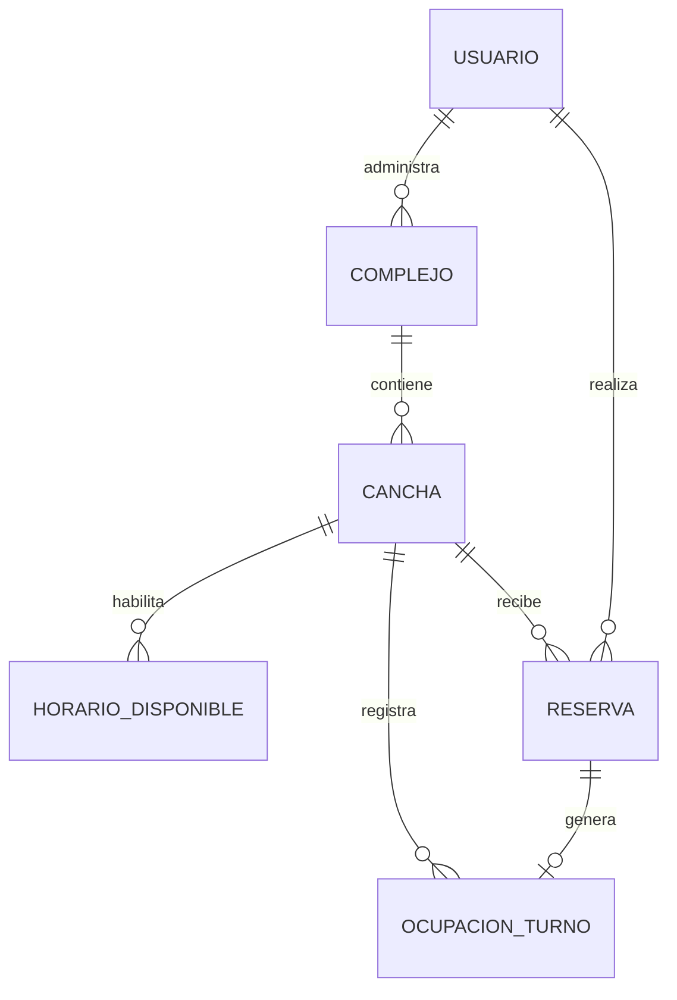

# Modelo de datos propuesto

La propuesta adopta un monolito modular en tres capas y MySQL. Las entidades siguen el modelo del informe integrador.

La ocupación activa tendría una clave primaria compuesta por cancha, fecha y hora. Crear la reserva y la ocupación en una transacción permitiría revertir la segunda solicitud que intente ocupar el mismo turno. La cancelación eliminaría la ocupación dentro de una transacción y conservaría la reserva en el historial.
